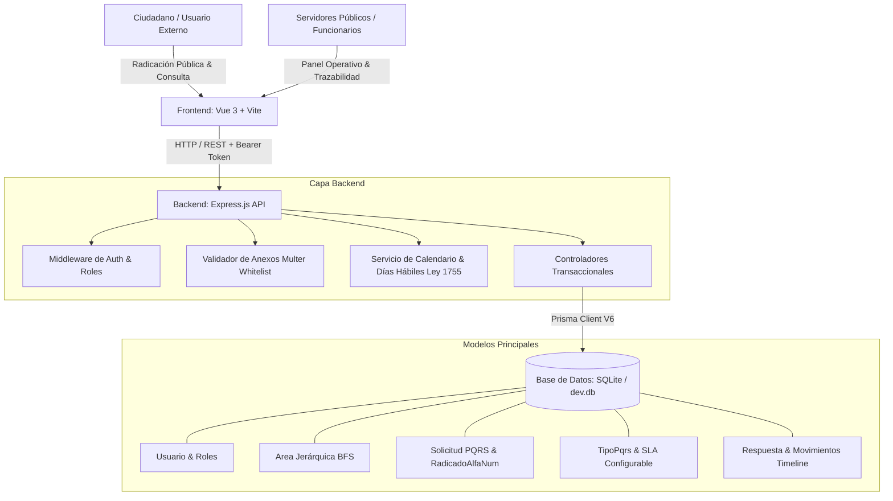

<div align="center">

# 🏛️ Plataforma Integral de Gestión de PQRS
### *Cumplimiento Normativo de la Ley Estatutaria 1755 de 2015 (Colombia)*

Sistema Full-Stack de nivel gubernamental y corporativo para la recepción, enrutamiento jerárquico, cálculo de términos legales y trazabilidad forense de Peticiones, Quejas, Reclamos, Sugerencias y Recursos.

[](https://nodejs.org/)
[](https://expressjs.com/)
[](https://vuejs.org/)
[](https://vitejs.dev/)
[](https://www.prisma.io/)
[](https://www.sqlite.org/)
[](https://jestjs.io/)
[](LICENSE)

---

</div>

## 📌 Visión General del Proyecto

En Colombia, el derecho de petición está tutelado como derecho fundamental bajo el **Artículo 23 de la Constitución Política** y regulado por la **Ley Estatutaria 1755 de 2015**. Las entidades públicas y privadas que prestan servicios públicos se enfrentan a sanciones disciplinarias y fallos de tutela por la pérdida de términos legales.

Esta plataforma proporciona una solución tecnológica robusta, auditable y de fácil despliegue que automatiza la radicación ciudadana, el cálculo riguroso de vencimientos (excluyendo festivos nacionales y fines de semana), la delegación piramidal interna entre áreas organizacionales y la emisión de actuaciones administrativas inmutables.

---

## ✨ Características Principales

| Módulo | Descripción |
| :--- | :--- |
| **⏱️ Motor de Plazos Legales** | Cálculo algorítmico de fechas máximas de respuesta descartando automáticamente fines de semana y festivos oficiales de Colombia (**Ley 51 de 1983 - Ley Emiliani**). |
| **🚦 Semáforos SLA en Vivo** | Clasificación visual instantánea en la bandeja operativa: 🟢 **Verde** (término holgado), 🟡 **Amarillo** (alerta temprana, ≤ 3 días hábiles restantes) y 🔴 **Rojo** (vencido, con conteo matemático de días hábiles en mora). |
| **⚙️ Tipos de PQRS Dinámicos** | Motor configurable de tipos de solicitudes. Permite definir plazos en días hábiles (ej. 5 días para Recursos de Queja, 10 para Información, 15 para Peticiones, 30 para Consultas) y requerimientos de **anexos obligatorios** con validación multicapa. |
| **🏢 Jerarquías & Áreas Recursivas** | Estructura organizacional auto-referenciada con algoritmos de recorrido en árbol (*BFS*). Los gestores supervisan y delegan solicitudes de forma bimodal (a un empleado puntual o a una sub-área dependiente). |
| **📎 Bóveda Documental Blindada** | Admisión controlada de anexos mediante `multer` (hasta 5 archivos, máximo 5 MB en total). *Whitelist* estricta de tipos MIME (PDF, DOCX, XLSX, TXT, IMG, ZIP) que previene la inyección de binarios maliciosos. |
| **📜 Actuaciones & Congelación de Términos** | Emisión de oficios formales: *Respuesta Final*, *Respuesta Parcial*, *Solicitud de Ampliación de Información* (que pausa los términos legales y los revive al recibir respuesta) y *Desistimiento Tácito*. |
| **🛡️ Auditoría Forense Inmutable** | Registro cronológico inalterable en la tabla `Movimiento` que documenta cada radicación, asignación, traslado, congelamiento o cierre de expediente. |
| **🔐 Autenticación y 5 Niveles de Roles** | Control de acceso basado en tokens JWT y hashing con Bcrypt: `SUPERADMIN`, `ADMIN`, `GESTOR`, `AGENTE` y `USUARIO_EXTERNO`. |
| **🎨 Interfaz Glassmorphism** | Diseño institucional premium desarrollado con Vanilla CSS estricto, paleta corporativa azul marina, micro-animaciones reactivas y diálogos emergentes montados sobre `<Teleport to="body">`. |

---

## 🏗️ Arquitectura de la Solución



---

## 👥 Roles del Sistema y Cuentas Preconfiguradas

Para facilitar la auditoría y evaluación inmediata del proyecto, se incluyen semillas de datos preconfiguradas con las siguientes credenciales:

| Rol | Correo / Identificador | Contraseña Base | Alcance / Permisos |
| :--- | :--- | :--- | :--- |
| **SUPERADMIN** | `superadmin@sistema.gov.co` | *Generada en setup / seed* | Control absoluto, CMS genérico de Base de Datos y configuración de entidad. |
| **ADMIN** | `admin@entidad.gov.co` | `Pqrs2026*` | Gestión de todas las PQRS, administración de usuarios, áreas organizacionales y tipos de PQRS. |
| **GESTOR** | `gestor.juridica@entidad.gov.co` | `Pqrs2026*` | Supervisión de área y jerarquías subordinadas. Asignación y delegación de radicados. |
| **AGENTE** | `agente1@entidad.gov.co` | `Pqrs2026*` | Bandeja individual de solicitudes asignadas, emisión de actuaciones y respuestas. |
| **USUARIO_EXTERNO** | `1122334455` | *Sin contraseña / Opcional* | Radicación ciudadana anónima o autenticada, consulta pública por número de radicado. |

---

## 🚀 Guía de Instalación y Puesta en Marcha

### Prerrequisitos
- **Node.js** (v18.0.0 o superior recomendado)
- **npm** (v9.0.0 o superior)
- **Git**

### 1. Clonar el Repositorio
```bash
git clone https://github.com/juantamayomolina/Pqrs.git
cd Pqrs
```

### 2. Configurar el Backend
```bash
# Instalar dependencias del servidor
npm install

# Generar el cliente de Prisma y aplicar esquema
npx prisma generate
npx prisma db push

# Poblar datos iniciales y tipos de PQRS
node seed_tipos_pqrs.js
node seed_areas.js
node seed_agentes.js
```

### 3. Configurar el Frontend
```bash
cd frontend
npm install
cd ..
```

### 4. Ejecución del Entorno de Desarrollo
Para utilizar la plataforma se recomienda abrir dos consolas simultáneas:

**Consola 1 (Servidor API Backend - Puerto 3000):**
```bash
npm run dev
# Servidor activo en http://localhost:3000
```

**Consola 2 (Cliente Web Vue 3 - Puerto 5173):**
```bash
cd frontend
npm run dev
# Interfaz web activa en http://localhost:5173
```

---

## 🧪 Pruebas Unitarias y de Integración

La suite de pruebas automatizadas está construida con **Jest** y **Supertest**, garantizando la precisión en los cálculos normativos y la integridad transaccional de los endpoints:

```bash
# Ejecutar todas las pruebas del sistema
npm test
```

**Resumen de Cobertura de Pruebas:**
- `src/services/fechas.service.test.js`: Validación matemática de días hábiles, saltos de fines de semana y exclusión de festivos de Semana Santa y festivos nacionales.
- `src/routes/pqrs.routes.test.js`: Pruebas de integración E2E sobre el ciclo de vida de radicación de PQRS, asignación de entidad global y consulta pública por código alfanumérico.

---

## 📡 Resumen de Endpoints Principales de la API

### Módulo Ciudadano & Radicación
- `POST /api/pqrs` — Radicación formal de PQRS (admite `multipart/form-data` para anexos).
- `GET /api/pqrs/:radicado` — Consulta del estado, trazabilidad y actuaciones de un expediente.
- `GET /api/tipos-pqrs` — Listado de tipos de PQRS activos y sus requerimientos normativos.

### Módulo Administrativo & Autenticación
- `POST /api/auth/login` — Autenticación y entrega de Bearer Token JWT.
- `GET /api/pqrs/panel/todas` — Bandeja administrativa con filtrado, sorting y paginación.
- `POST /api/pqrs/:id/actuacion` — Emisión de respuestas y actuaciones institucionales.
- `POST /api/pqrs/:id/asignar` — Asignación bimodal de expedientes a funcionarios o sub-áreas.
- `GET /api/tipos-pqrs/admin` — Gestión integral de tipos de solicitudes y términos legales.
- `GET /api/superadmin/tablas/:tabla` — CMS dinámico para manipulación de esquemas del sistema.

---

## 📄 Marco Legal de Referencia
- **Constitución Política de Colombia (1991)**: Artículo 23 (Derecho Fundamental de Petición).
- **Ley Estatutaria 1755 de 2015**: Por medio de la cual se regula el derecho fundamental de petición y se sustituye un título del Código de Procedimiento Administrativo y de lo Contencioso Administrativo.
- **Ley 51 de 1983 (Ley Emiliani)**: Traslado de días festivos al día lunes para efectos laborales y cómputo de términos administrativos.

---

## 👨‍💻 Autor y Contribuciones
Desarrollado por **[juantamayomolina](https://github.com/juantamayomolina)**.  
Proyecto de código abierto bajo licencia **MIT**. Se admiten contribuciones mediante Pull Requests respetando los estándares de testing y arquitectura definidos.
